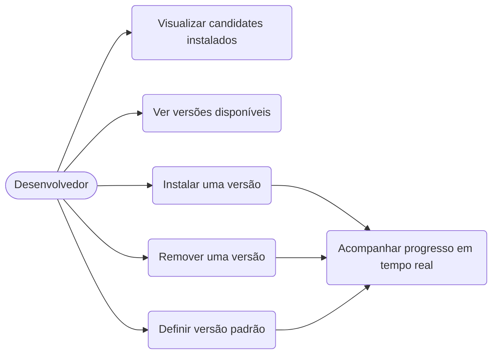
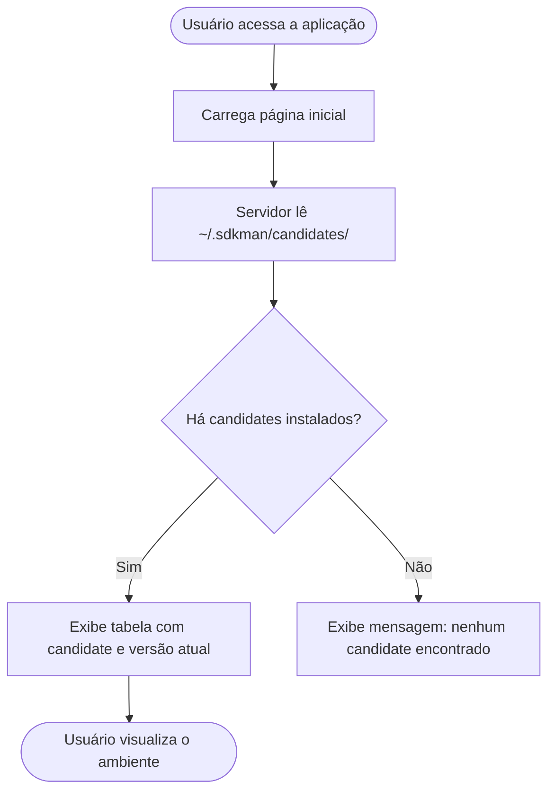
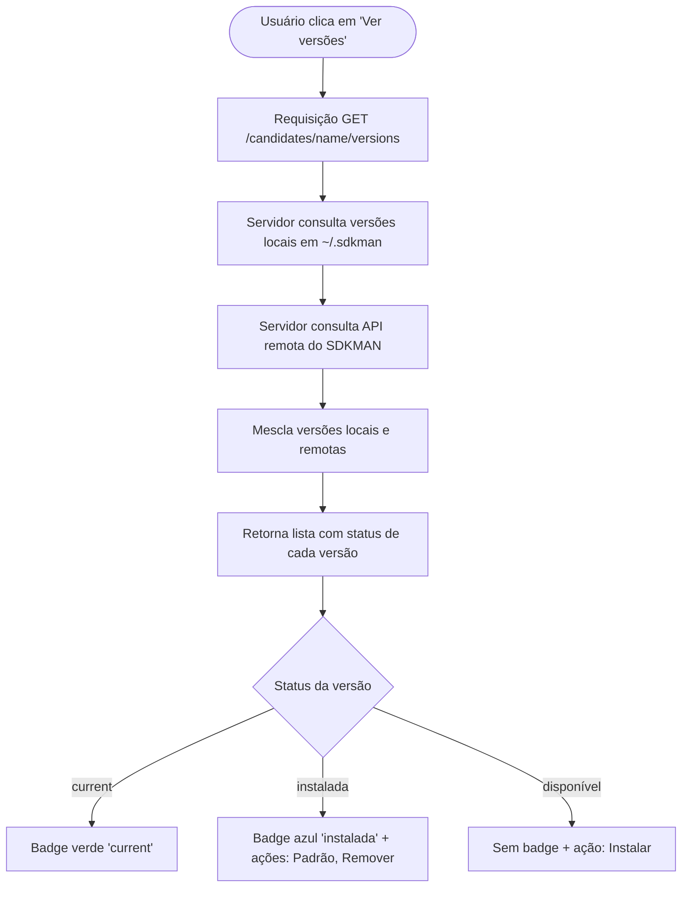
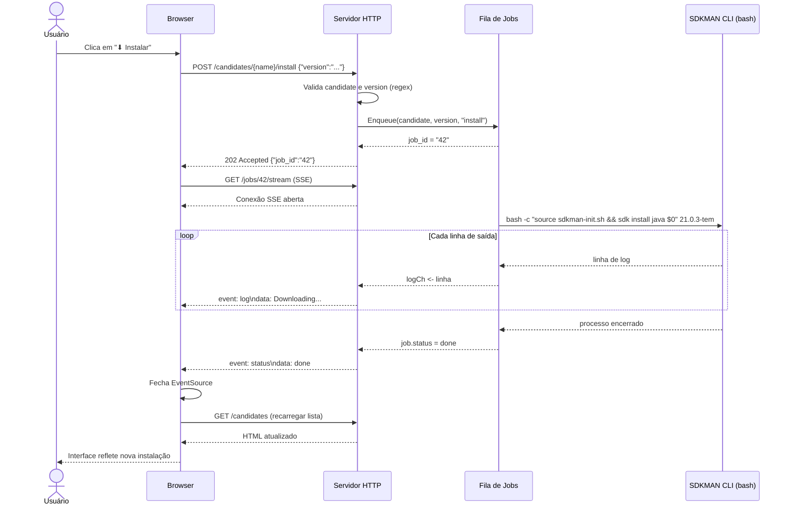
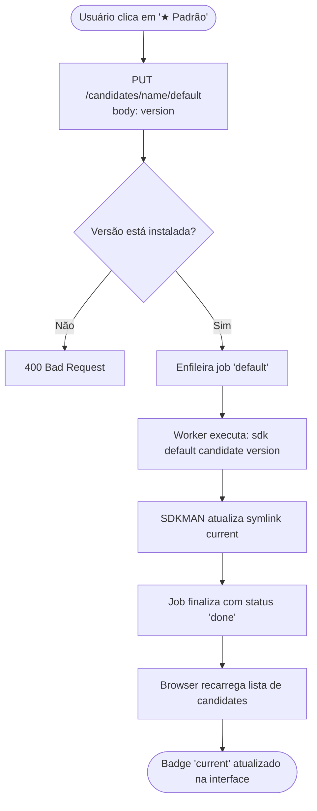
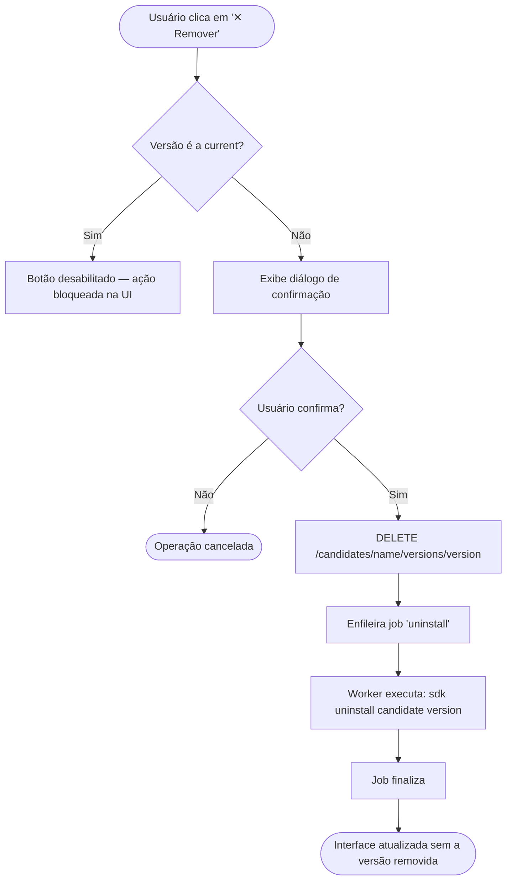
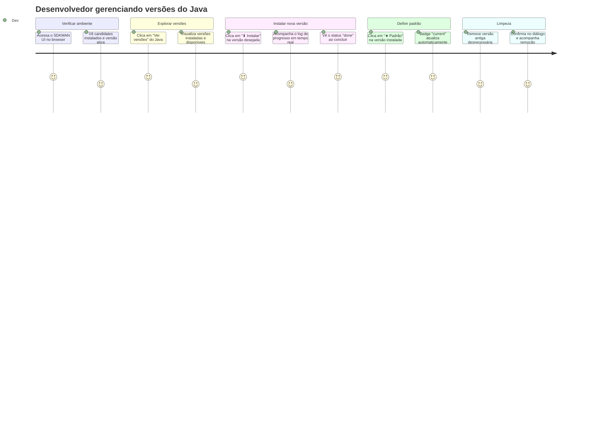

# SDKMAN UI — Documentação de Negócio

## 1. Visão do Produto

O **SDKMAN UI** resolve um problema cotidiano de desenvolvedores que trabalham com múltiplas versões de ferramentas JVM: o gerenciamento via linha de comando do SDKMAN é eficiente, mas exige memorização de comandos e não oferece visibilidade rápida do estado atual das instalações.

O produto oferece uma interface web local, leve e segura que traduz as operações do SDKMAN em ações visuais simples — sem abandonar a robustez e o controle que o SDKMAN já oferece.

---

## 2. Personas

### Dev Backend — "Marco"
- Trabalha com múltiplos projetos Java simultâneos, cada um exigindo uma versão diferente do JDK.
- Troca de versão frequentemente e precisa saber rapidamente qual está ativa.
- Não lembra os identificadores exatos das versões disponíveis.

### Tech Lead — "Ana"
- Padroniza o ambiente de desenvolvimento da equipe.
- Precisa instalar e definir versões padrão em múltiplas máquinas.
- Valoriza rastreabilidade: quer ver o log de cada operação realizada.

### Dev Júnior — "Lucas"
- Recém-chegado ao ecossistema JVM.
- Prefere interfaces visuais a comandos de terminal.
- Comete erros ao digitar versões; se beneficia da validação automática.

---

## 3. Casos de Uso

---

## 4. Glossário de Negócio

| Termo | Definição |
|---|---|
| **Candidate** | Ferramenta gerenciada pelo SDKMAN (Java, Maven, Gradle, Kotlin, Scala…) |
| **Versão** | Identificador único de uma release de um candidate (ex.: `21.0.3-tem`) |
| **Versão atual (current)** | Versão ativa no momento — apontada pelo symlink `current` |
| **Versão instalada** | Versão baixada e presente localmente em `~/.sdkman/candidates/` |
| **Versão disponível** | Versão listada na API do SDKMAN mas ainda não baixada |
| **Job** | Operação assíncrona de escrita (install, uninstall, default) com log de progresso |
| **SSE** | Server-Sent Events — mecanismo de streaming do log do job para o browser |

---

## 5. Regras de Negócio

| ID | Regra |
|---|---|
| RN01 | Apenas uma operação de escrita pode estar em execução por vez |
| RN02 | Uma versão não pode ser removida se for a versão atual (current) |
| RN03 | Candidatos e versões devem seguir o padrão `^[a-z0-9._-]+$` |
| RN04 | O servidor só aceita conexões de `127.0.0.1` por padrão |
| RN05 | Operações de escrita têm timeout máximo configurável (padrão: 10 minutos) |
| RN06 | A fila de jobs tem capacidade máxima configurável (padrão: 64) |

---

## 6. Fluxos de Negócio

### 6.1 Fluxo principal — Visualizar estado do ambiente

---

### 6.2 Fluxo — Explorar versões de um candidate

---

### 6.3 Fluxo — Instalar uma versão

---

### 6.4 Fluxo — Definir versão padrão

---

### 6.5 Fluxo — Remover uma versão

---

## 7. Jornada do Usuário

---

## 8. Escopo MVP vs. Futuro

### MVP (implementado)

| Funcionalidade | Status |
|---|---|
| Listar candidates instalados | ✅ |
| Listar versões disponíveis | ✅ |
| Instalar versão com log em tempo real | ✅ |
| Remover versão instalada | ✅ |
| Definir versão padrão | ✅ |
| Interface web responsiva | ✅ |
| Configuração via arquivo YAML | ✅ |
| Execução via Docker | ✅ |

### Backlog futuro

| Funcionalidade | Prioridade |
|---|---|
| Atualizar candidates desatualizados (`sdk upgrade`) | Alta |
| Suporte a `.sdkmanrc` por projeto | Alta |
| Histórico de operações realizadas | Média |
| `sdk use` (versão temporária na sessão) | Média |
| Notificação de novas versões disponíveis | Baixa |
| Autenticação para uso em rede local | Baixa |
