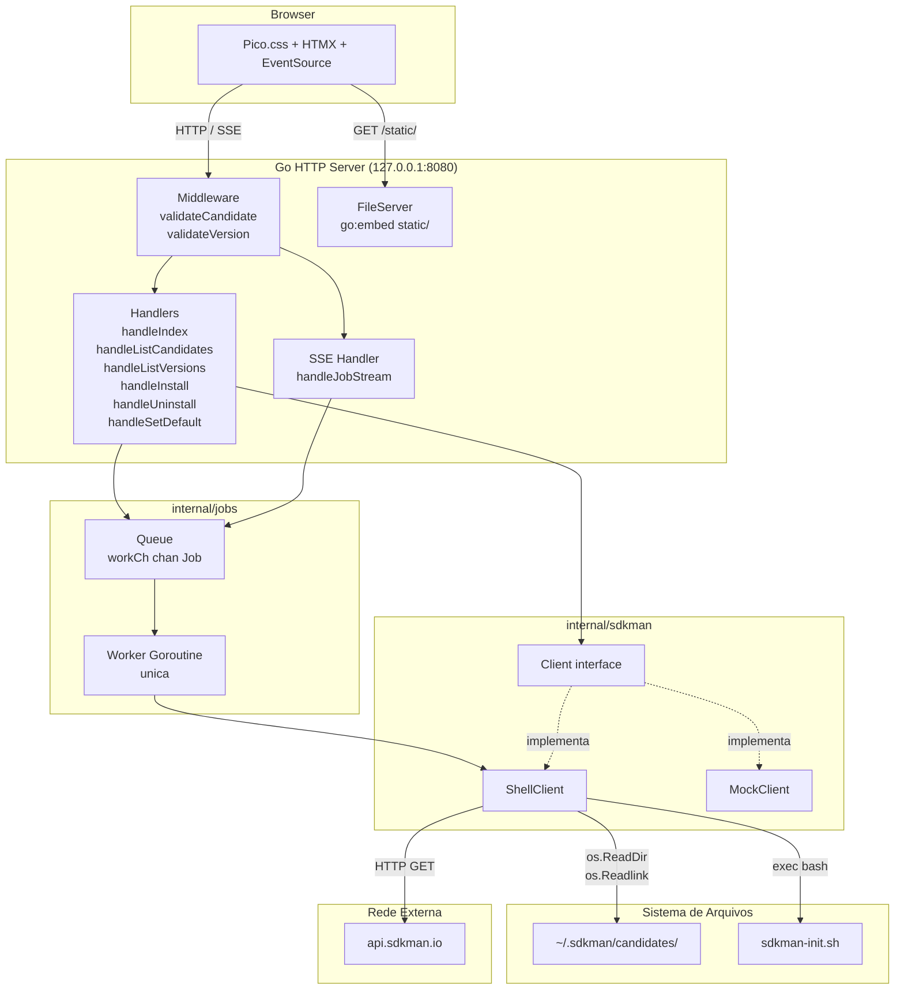
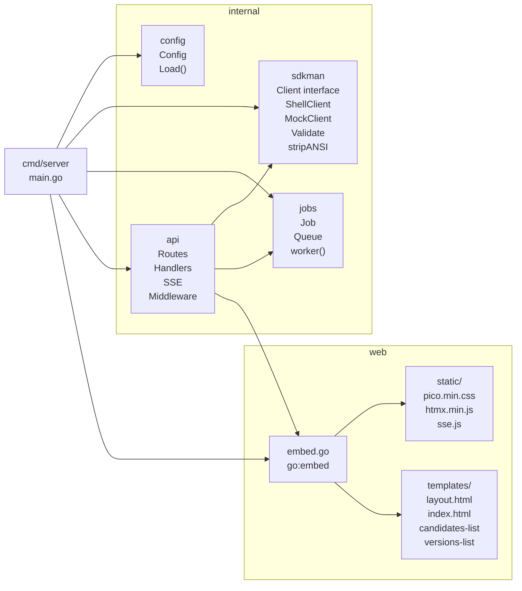
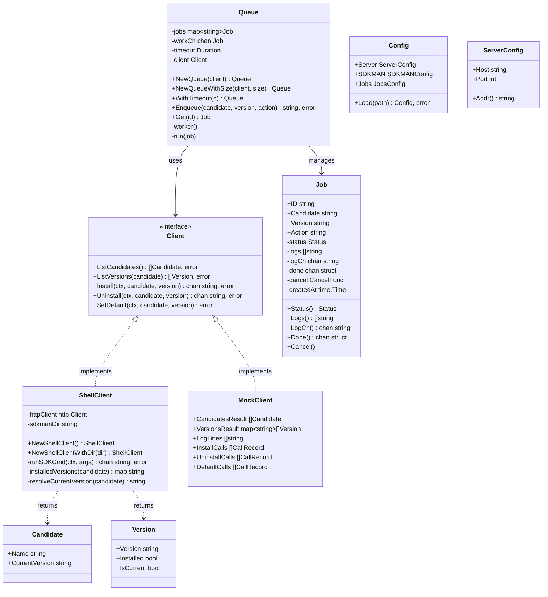
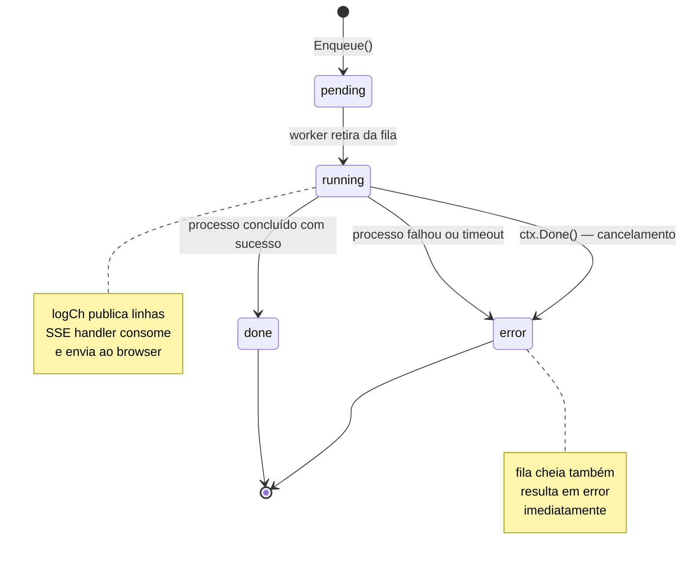
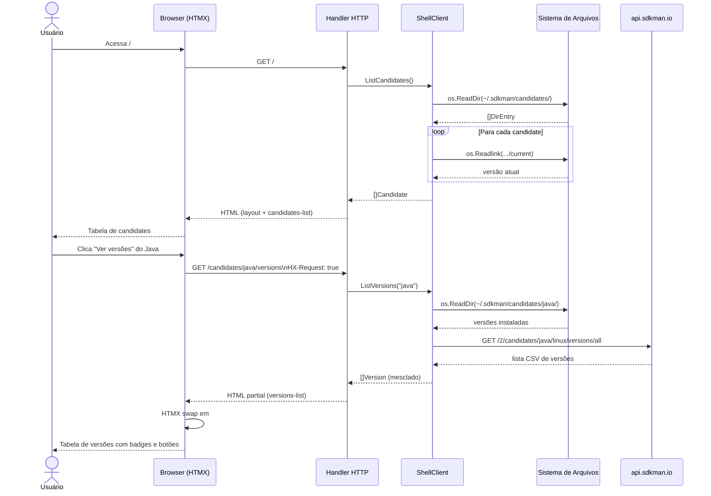
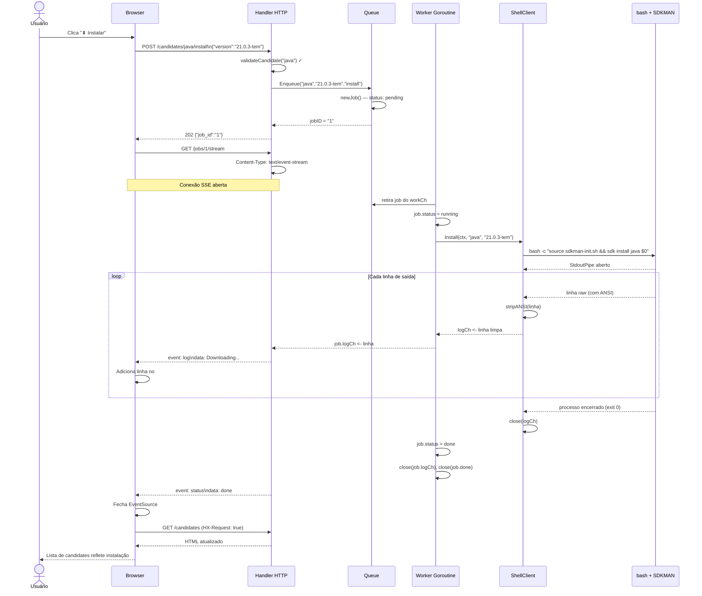
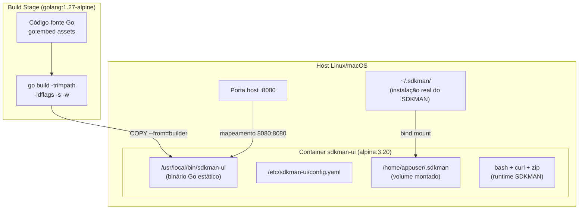
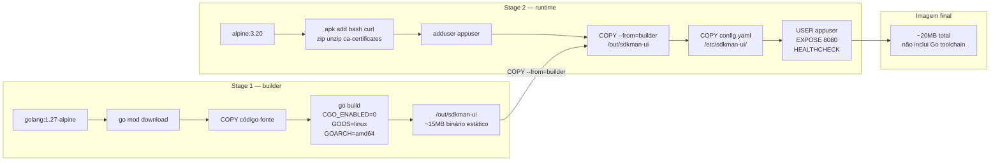
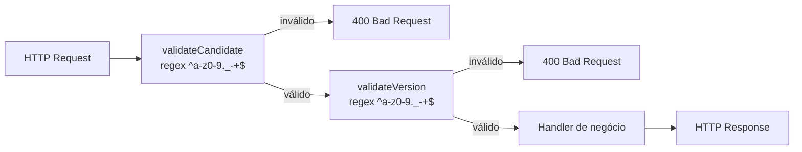
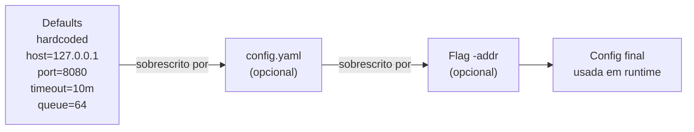

# SDKMAN UI — Documentação Técnica

## 1. Visão Geral da Arquitetura

O SDKMAN UI é uma aplicação web fullstack em Go organizada em camadas bem definidas. O binário único embute templates HTML, CSS e JavaScript via `go:embed`, eliminando dependências externas em tempo de execução.



---

## 2. Estrutura de Pacotes



---

## 3. Modelo de Classes Simplificado



---

## 4. Modelo de Estados do Job



---

## 5. Fluxo de Dados — Leitura



---

## 6. Fluxo de Dados — Escrita com SSE



---

## 7. Arquitetura de Deploy — Docker



---

## 8. Fluxo de Build Docker Multi-Stage



---

## 9. Middleware Chain



---

## 10. Configuração — Precedência



---

## 11. Estrutura de Arquivos — Referência Completa

```
sdk-ui/
├── cmd/
│   └── server/
│       └── main.go               # Entrypoint: monta deps, inicia HTTP
│
├── internal/
│   ├── config/
│   │   ├── config.go             # Config, ServerConfig, SDKMANConfig, JobsConfig
│   │   └── config_test.go        # Testes de Load() e validação
│   │
│   ├── sdkman/
│   │   ├── client.go             # Interface Client, structs Candidate e Version
│   │   ├── shell.go              # ShellClient: FS + exec bash + API HTTP
│   │   ├── mock.go               # MockClient: testes unitários
│   │   ├── validate.go           # ValidateCandidate(), ValidateVersion()
│   │   └── ansi.go               # stripANSI()
│   │
│   ├── jobs/
│   │   ├── job.go                # Job: ID, Status, logCh, done, cancel
│   │   └── queue.go              # Queue: workCh, worker goroutine, Enqueue, Get
│   │
│   └── api/
│       ├── routes.go             # RegisterRoutes()
│       ├── handlers.go           # handleIndex, Candidates, Versions, Install…
│       ├── sse.go                # handleJobStream: SSE streaming
│       └── middleware.go         # validateCandidate, validateVersion, chain()
│
├── web/
│   ├── embed.go                  # //go:embed static templates
│   ├── static/
│   │   ├── pico.min.css          # Pico.css v2 (~83KB)
│   │   ├── htmx.min.js           # HTMX 1.9.12 (~48KB)
│   │   └── sse.js                # htmx-ext-sse 2.2.2 (~9KB)
│   └── templates/
│       ├── layout.html           # Base: head, nav, estilos, scripts
│       ├── index.html            # Página principal (bloco "content")
│       ├── candidates-list.html  # Partial: tabela de candidates
│       └── versions-list.html    # Partial: tabela de versões + SSE script
│
├── doc/
│   ├── business.md               # Documentação de negócio com diagramas
│   └── technical.md              # Este arquivo
│
├── .kiro/specs/
│   └── architecture.md           # Especificação de arquitetura detalhada
│
├── Dockerfile                    # Multi-stage: golang:1.27-alpine + alpine:3.20
├── docker-compose.yml            # Stack Docker Compose
├── .dockerignore
├── config.yaml                   # Configuração padrão
├── Makefile                      # Targets Go e Docker
└── go.mod
```

---

## 12. Decisões Técnicas

| Decisão | Escolha | Razão |
|---|---|---|
| Router HTTP | `net/http.ServeMux` nativo | Go 1.22 suporta method+path patterns sem deps externas |
| Templates | `html/template` stdlib | Escape automático de HTML; sem codegen |
| Frontend | HTMX + Pico.css embutidos | Zero build step; HTML server-driven; sem SPA complexity |
| Streaming | SSE (Server-Sent Events) | Unidirecional, suficiente para log; mais simples que WebSocket |
| Serialização de jobs | Worker goroutine único | SDKMAN não é thread-safe por design |
| Identificador de job | Contador atômico | Simples, ordenado, sem dependências externas (UUID desnecessário) |
| Binário | `go:embed` + build estático | Deploy zero-dependency; funciona offline |
| Container base | `alpine:3.20` | Imagem mínima (~5MB); bash disponível para o SDKMAN |
| Configuração | YAML + flags | Legível para humanos; flags para CI/CD e override pontual |
